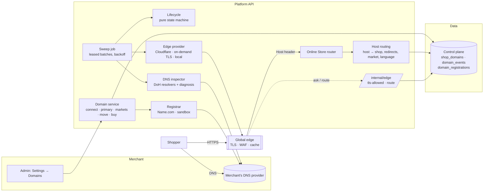
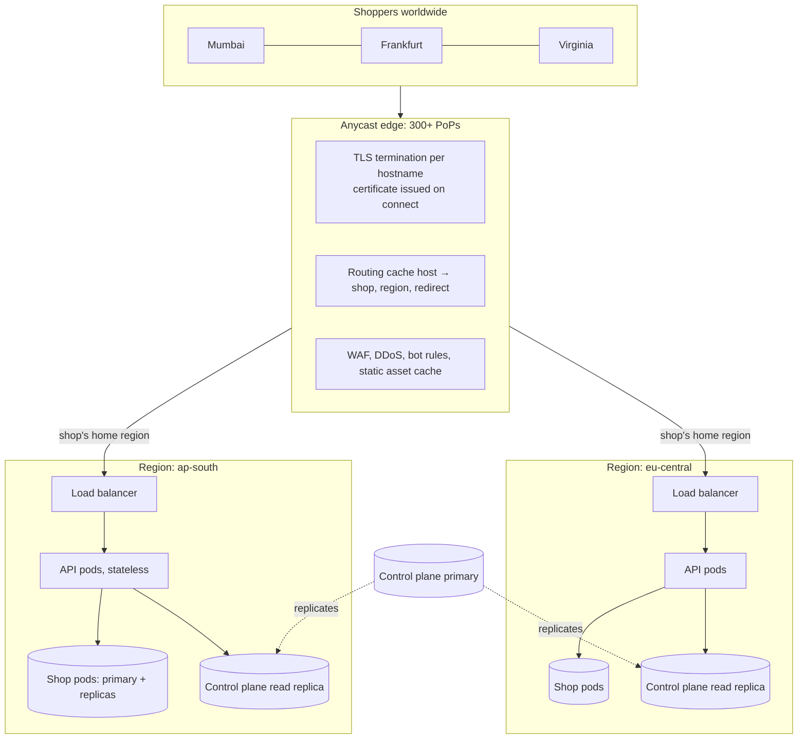
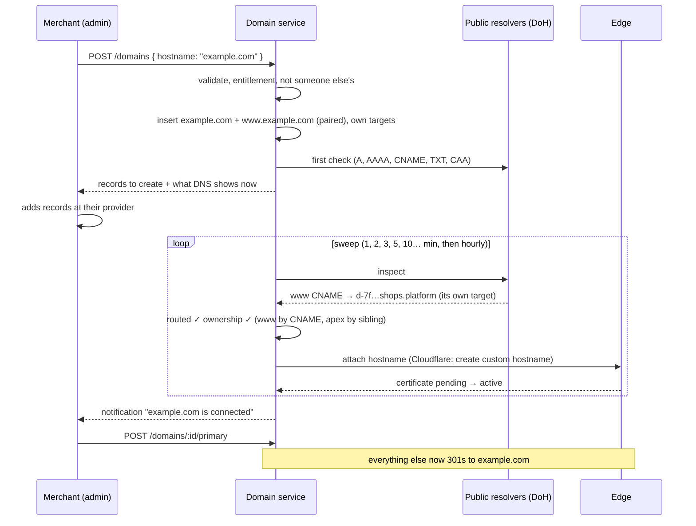
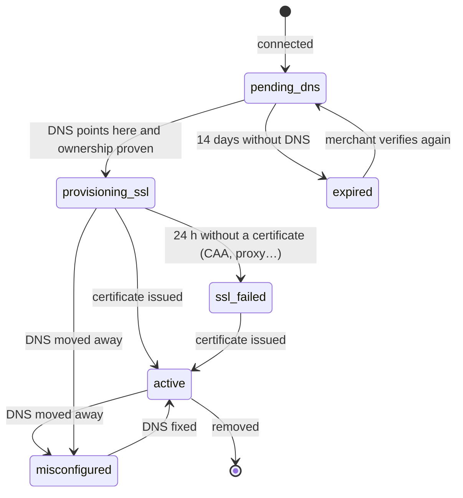

# Custom domains and the global edge

How a store gets its own address — connected, bought, or moved from another
store — and how the platform serves millions of them securely worldwide.
Shopify's model (Settings → Domains), built for global scale. Read with
[SYSTEM_DESIGN.md](SYSTEM_DESIGN.md) and [ONLINE_STORE.md](ONLINE_STORE.md).

**In one paragraph.** Every store starts on `<handle>.<platform domain>`.
A merchant connects a domain they own (`example.com` — `www.example.com` comes
with it), gets the exact DNS records to create with a live checklist, and the
platform does the rest: it checks DNS from public resolvers on a backing-off
schedule, proves ownership (a CNAME to the domain's own target, a TXT record,
or its www/apex partner), tells the edge to serve the hostname and issue its
certificate, and notifies the merchant when it is live. One domain is
primary; every other address 301-redirects there with the path kept. A domain
can instead serve a market in its language (`example.fr` → France, euros,
French). Domains can be bought in the admin (registered, pointed and
connected in one step, renewed on the store's bill), moved from another store
with a TXT proof, and are watched for as long as they exist.

---

## 1. What a merchant can do (Shopify parity)

| Shopify | Here | Where |
|---|---|---|
| Connect existing domain (A + CNAME, verify) | Connect with a per-domain CNAME target, apex/www added together, live checklist, provider-specific help, automatic re-checks | `domains.service.ts#connect`, admin `ConnectDomainDialog` |
| Buy a domain | Search with prices in the billing currency, register, auto-DNS, auto-connect, billed on the next invoice, auto-renew, transfer-out code | `registrar/registrar.ts`, `#buy`, `renewDue` |
| Transfer a domain to Shopify | "Transfer domain here" on a connected domain: eligibility and price (one year added), the unlock + auth-code steps, the registries' days-long handover followed by a job, billed only on completion, merchant told either way | `#transferQuote`, `#transferIn`, `advanceTransfers`, admin `TransferInDialog` |
| Primary domain, redirect other domains | 301 to the primary (path and query kept), including the platform subdomain; per-domain "redirect" switch | `hostRouting.ts`, Online Store middleware |
| SSL issued automatically | The edge issues and renews; the platform tracks issuer and expiry, and redirects to HTTPS + HSTS once live | `edge/edgeProvider.ts` |
| International domains (per market / language) | A domain belongs to a market and a language; its www partner follows; the country picker moves shoppers between market domains | `#update`, storefront market + language middleware |
| Language domains (`fr.example.com`) | A domain outside any market with a language is that language's home for every market: `/fr/` pages elsewhere 301 there, hreflang and the language picker point there, its www partner redirects to it; one per language | `hostRouting.ts#languageHomes`, storefront language middleware, `POST /localization` |
| "Domain connected to another store" | Move it with a TXT proof (stateless HMAC token); the old store is notified and falls back to its platform address | `#transferInstructions`, `#completeTransfer` |
| Domain status and troubleshooting | Lifecycle (`pending_dns → provisioning_ssl → active`, `misconfigured`, `ssl_failed`, `expired`), plain-language problems (old Shopify/Wix/Squarespace records, Cloudflare proxy, CAA, propagation), history | `dns/inspect.ts#diagnose`, `lifecycle.ts`, `domain_events` |
| Operators | Every store's domains by status, "check now" | `GET /platform/api/v1/domains`, console `ConsoleDomainsPage` |

---

## 2. High-level design

### 2.1 Components

### 2.2 Global topology

* **The edge terminates TLS** for every hostname close to the shopper, so a
  handshake never crosses an ocean. The application never holds a
  certificate.
* **Routing by hostname happens at the edge**: `GET /internal/edge/route`
  answers `{ shop, pod, redirect, https, market, locale, locked, version,
  cache_ttl }`, and the edge worker (`deploy/edge/worker/storefront.ts`, a
  Cloudflare Worker) keeps it for `ROUTE_TTL` seconds per location, sends the
  request to the shop's home region (`POD_ORIGINS`), answers redirects and
  HTTPS upgrades itself, and serves anonymous pages from its cache keyed by
  the shop's content version — so a change needs no purge. The application
  also resolves hostnames itself, so a single-region deployment needs no
  edge logic at all.
* **Every API pod is stateless**; a region scales by adding pods. Shops are
  placed on pods (databases) in a region (`shops.pod_id`) — data residency
  and blast-radius both follow from that.
* **The control plane** (shops, domains, identities) is small and read-mostly:
  one primary, a read replica per region. Hostname lookups read the local
  replica; writes (connect, primary change) go to the primary and reach
  caches through invalidation plus a 30–60 s TTL.

---

## 3. Flows

### 3.1 Connecting a domain

### 3.2 Lifecycle

`lifecycle.ts#nextState` is a pure function of (current status, DNS
diagnosis, edge certificate state, time): exhaustively unit-tested, no I/O.
It also decides the next check and whether to notify the merchant
(`connected`, `restored`, `misconfigured`, `ssl_failed`, `expired`).

### 3.3 Buying a domain

`GET /domains/search?q=` asks the registrar across the popular extensions
and converts prices into the store's billing currency (plus
`REGISTRAR_MARKUP_PERCENT`). `POST /domains/buy`:

1. rechecks availability, records the registration as `pending`;
2. registers it (the registrant is the merchant; WHOIS privacy on by default);
   a failure marks it `failed` and charges nothing;
3. creates the apex and www domains with ownership `registrar` (no proof
   needed), writes their DNS at the registrar (A/AAAA to the edge, www CNAME
   to its target), adds a `domain` line to the next platform invoice;
4. checks both straight away — they go live as soon as DNS answers.

`domains.renewals` (daily) renews auto-renew registrations 30 days before
expiry and bills them; a failure notifies the merchant and retries the next
day. "Transfer out" reveals the registrar's auth code (audited).

### 3.3a Transferring a domain in

A domain registered elsewhere, already connected and live here (so the store
never goes dark), can move its registration to the platform's registrar:

1. `GET /domains/:id/transfer` — eligible? (not already managed here or by
   another store, not premium, the extension transfers) and the price: the
   registrar's transfer price (a year is added), marked up and converted
   like a purchase.
2. The merchant unlocks the domain at their current provider and gets the
   auth (EPP) code; `POST /domains/:id/transfer { auth_code }` asks the
   registrar to start. The registration is recorded as `transferring`; a
   code the registrar refuses outright comes back as a 409 and nothing is
   recorded as owed.
3. `domains.transfers` (every 10 minutes) asks the registrar about each
   transfer in flight. **Completed**: the registration becomes `active` with
   its new expiry, a `domain` line is added to the next invoice (the only
   charge), and the store's addresses on the domain become `transferred`
   (renewals, auto-renew and transfer-out now apply). **Failed** (the losing
   registrar refused, or nothing after 10 days): `failed` with the reason;
   the merchant is told nothing was charged. DNS is not touched either way —
   it stays at the merchant's DNS provider.

### 3.4 Moving a domain from another store

A hostname is unique across the platform. Connecting one that another store
holds returns `409 DOMAIN_TAKEN` with a TXT record whose value is an HMAC of
(this store, hostname) — nothing is stored, and no other store can produce
it. Once the record is in DNS, `POST /domains/transfer/complete` moves the row
(new routing target, ownership `transfer`), repoints the old store's primary
to its platform address if needed, notifies the old store, and records both
sides in `domain_events` and the audit log.

---

## 4. Security

* **Ownership, not just routing.** Anyone can point a name at a shared
  CNAME. A subdomain proves ownership only by pointing at *its own* target
  (`d-<16 hex>.<zone>`, unguessable, unique index); an apex proves it with the
  TXT token or through its www partner. A domain removed from a store but
  still pointing here cannot be claimed by another store via that CNAME (the
  new row gets a new target) — it needs the TXT proof.
* **No certificates on demand for strangers.** The on-demand-TLS edge asks
  `/internal/edge/tls-allowed` before issuing; only verified domains of
  stores that are not closed are allowed. Cloudflare hostnames are only
  created after ownership is proven.
* **Internal endpoints** require `EDGE_SHARED_SECRET` (constant-time compare)
  and are blocked at the edge (`deploy/edge/Caddyfile`); without a secret
  they answer only outside production.
* **Redirects never point at a broken padlock.** A redirect goes to `https://`
  only when that domain's certificate is live; HTTPS is enforced and HSTS
  (1 year, without `includeSubDomains` — the merchant's other subdomains may
  not be on HTTPS) sent only for domains with a live certificate.
* **CAA** records that would block the edge's CA are detected and explained
  before issuance fails.
* **Rate limits**: connect 20/10 min, verify 20/min, buy 5/10 min, transfer
  codes 5/10 min per store; every change is in the audit log and the
  domain's history.

---

## 5. Scale

| Concern | Design | Numbers |
|---|---|---|
| Checking millions of domains | Due-list on `(next_check_at, status)`; each worker claims a batch with one atomic `UPDATE … ORDER BY next_check_at LIMIT n` setting a lease id, then reads its rows. Dead workers' leases lapse. | 200 per claim, 10 concurrent checks per worker (`DOMAIN_SWEEP_*`); add workers to scale linearly |
| Not checking them all the time | Backoff per status (pending: 1,2,3,5,10,15,30 min then hourly to 72 h then 6-hourly; live: 6 h; misconfigured: 1 h then 6 h), ±20 % jitter so nothing aligns | 1 M live domains ≈ 46 checks/s fleet-wide |
| DNS query volume | Light checks for settled live domains (CNAME/A/AAAA only; TXT and CAA from the last full check); resolvers configurable — public DoH by default, the platform's own recursive resolvers (`DNS_RESOLVERS=https://…/dns-query`) at scale | ~140 queries/s at 1 M domains with light checks |
| Edge API budget | The edge is asked only while a certificate is being issued or within 3 weeks of expiry; steady-state health is DNS only | Onboarding is the only burst: 1 create + a few polls per new domain |
| Hostname → shop on every request | In-process cache (30 s, cleared on change on every pod) + `shopDirectory` cache; at the edge, the route answer kept `ROUTE_TTL` (10 s) per location by the edge worker | One small origin call per hostname per location every 10 s; pages themselves served from the edge |
| Multi-region | Control-plane read replica per region; shops on regional pods; edge routes to the shop's region | Writes to domains are rare (merchant actions) |
| Certificates | Issued and renewed by the edge (Cloudflare, or Caddy with shared storage so one issuance serves every region) | CA rate limits respected by issuing once, on proof |

---

## 6. Data model (control plane)

`shop_domains` (extended by migration 126):

| Column | Meaning |
|---|---|
| `hostname` (unique), `root_domain`, `pair_id` | the name, its registrable domain, its www/apex partner |
| `kind` platform/custom, `source` platform/connected/purchased | where it came from |
| `status` + `status_changed_at` | the lifecycle (§3.2) |
| `routing_target` (unique) | the domain's own CNAME target |
| `verification_status`, `ownership_method` (txt, cname, sibling, registrar, transfer, platform) | proof of ownership |
| `edge_provider`, `edge_hostname_id`, `certificate_status`, `certificate_issuer`, `certificate_expires_at` | the edge's view |
| `is_primary` (one per shop, enforced by a generated unique column), `redirect_to_primary`, `market_id`, `locale` | how it is used |
| `dns_snapshot` (JSON) | what the last check saw and concluded — the admin's checklist |
| `next_check_at`, `check_lease`, `check_attempts`, `last_checked_at`, `last_healthy_at` | the sweep |

`domain_events` (domain history: added, status_changed, primary, settings,
claimed, removed, transfer_requested, transferred_in, transfer_failed) and
`domain_registrations` (domains bought or transferred in — `kind` — with
registrar, order, status including `transferring`, price, renewal price,
currency, auto-renew, privacy, expiry). Platform invoice lines gain the
`domain` kind.

---

## 7. Interfaces

Admin API `/admin/api/:version/domains` (`shop.view` to read, `domains.manage`
to change): `GET /`, `GET /:id`, `POST /` (connect), `POST /:id/verify`,
`POST /:id/primary`, `PATCH /:id` (redirect, market, language),
`DELETE /:id`, `POST /transfer`, `POST /transfer/complete`,
`GET /search?q=`, `POST /buy`, `PATCH /registrations/:id`,
`POST /registrations/:id/transfer-code`.

Platform API: `GET /platform/api/v1/domains?status=&q=`,
`POST /platform/api/v1/domains/:id/check`.

Edge (internal): `GET /internal/edge/tls-allowed?domain=`,
`GET /internal/edge/route?host=`.

Online Store: requests on any non-primary address 301 to the primary (or,
for a market domain's partner, to the market's domain); `/cdn/`,
`/.well-known/`, `/internal/`, `/checkout(s)` and editor previews answer on
any host.

---

## 8. Configuration

| Variable | Default | Purpose |
|---|---|---|
| `EDGE_PROVIDER` | `local` (dev), `on_demand` (prod) | `cloudflare`, `on_demand`, `local` |
| `CLOUDFLARE_API_TOKEN`, `CLOUDFLARE_ZONE_ID` | — | Cloudflare for SaaS ([setup](../deploy/edge/CLOUDFLARE_FOR_SAAS.md)) |
| `EDGE_PROBE_ADDRESS` | first edge IP | where the on-demand edge's certificate is probed |
| `EDGE_SHARED_SECRET` | — | the edge's key to `/internal/edge/*` |
| `PLATFORM_EDGE_HOSTNAME` | `shops.<platform domain>` | the shared CNAME target |
| `PLATFORM_EDGE_TARGET_ZONE` | same | zone of per-domain targets (`*.<zone>` → edge) |
| `PLATFORM_EDGE_IPS`, `PLATFORM_EDGE_IPV6` | — | apex A/AAAA targets |
| `EDGE_CERTIFICATE_AUTHORITIES` | `letsencrypt.org,pki.goog` | for CAA checks |
| `DNS_RESOLVERS` | `cloudflare,google` (prod), `system` (dev) | or `static`, or DoH URLs |
| `DNS_STATIC_FILE` | — | development/test DNS |
| `PUBLIC_SUFFIX_FILE` | built-in subset | the full Public Suffix List |
| `REGISTRAR` | `sandbox` | `namecom` with `NAMECOM_USERNAME`, `NAMECOM_TOKEN`, `NAMECOM_API_URL` |
| `REGISTRAR_MARKUP_PERCENT` | 0 | resale margin |
| `SANDBOX_TRANSFER_SECONDS`, `SANDBOX_REGISTRAR_FILE` | 60, beside `DNS_STATIC_FILE` | development: how long a sandbox transfer takes, and where the sandbox keeps transfers so a worker sees what the API asked for |
| `DOMAIN_SWEEP_BATCH`, `DOMAIN_SWEEP_CONCURRENCY` | 200, 10 | per-worker sweep size |

---

## 9. Operating it

* **Metrics**: `domain_checks_total{outcome}`; domains by status
  (`GET /platform/api/v1/domains` counts) — alert on growth of
  `misconfigured` and `ssl_failed`, and on sweep lag (oldest `next_check_at`
  in the past).
* **Runbooks** (the admin shows the same words to the merchant):
  * *Stuck in provisioning*: CAA blocking the CA, or the merchant's own
    Cloudflare proxy (orange cloud) in front — both named in the diagnosis.
  * *Misconfigured*: DNS changed at the provider (often a provider migration
    or an expired domain). Nothing breaks on the platform side; the store
    stays on its other addresses.
  * *"Connected to another store"*: the move-with-TXT flow; support never
    moves domains by hand.
* **Local development**: `DNS_STATIC_FILE=<file>` makes the checks read DNS
  from a JSON file (`{"www.example.com": {"CNAME": ["d-….shops.x.com"]}}`);
  `REGISTRAR=sandbox` writes a bought domain's records there, so connect,
  buy, primary and redirects all run locally. `EDGE_PROVIDER=local` treats
  certificates as issued and never redirects to HTTPS.
* **Tests**: `test/unit/domains.test.ts` — hostnames and the public-suffix
  rules, DoH answer parsing (split TXT, RFC 3597 CAA), diagnosis (unique vs
  shared targets, stray and other-platform records, Cloudflare proxy, CAA,
  propagation), the lifecycle and its schedule, the Cloudflare adapter against
  a stubbed API, the sandbox registrar. Admin
  `scripts/ui-smoke-domains.mjs` walks connect → DNS → live → primary →
  redirect → market domain → buy in a browser.
