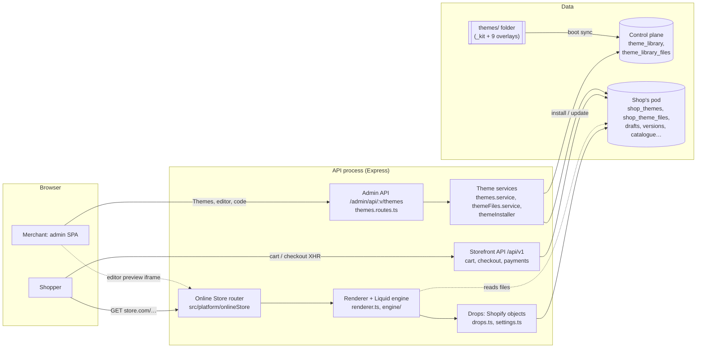
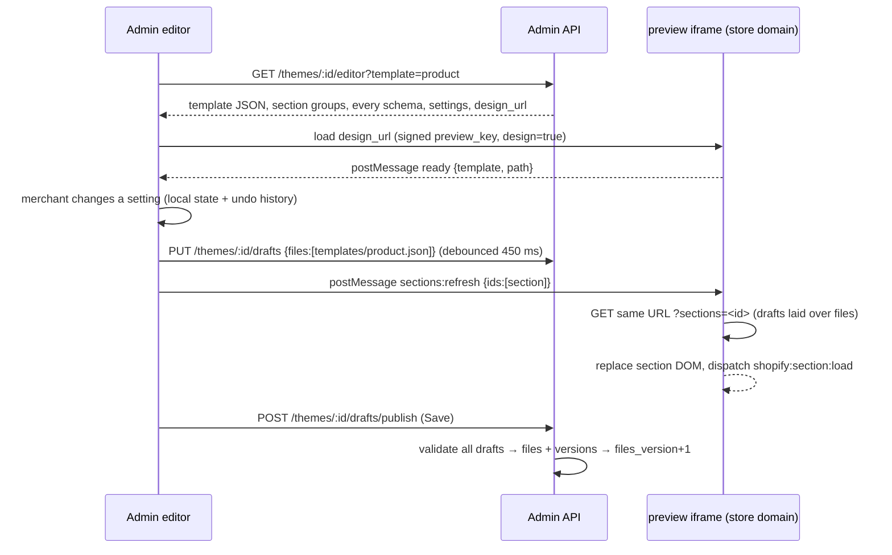
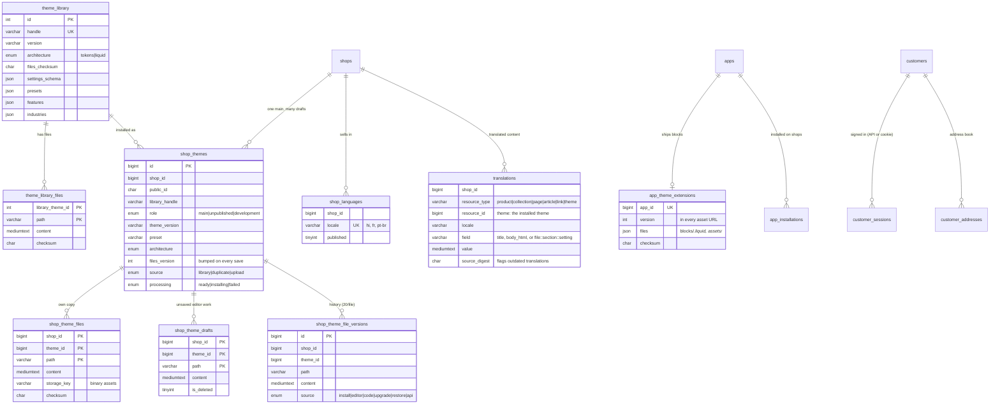
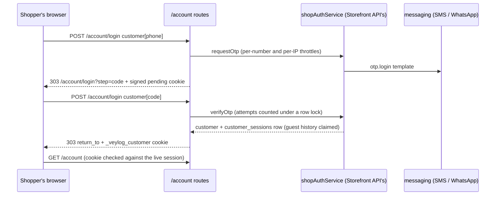

# Online Store and themes

How a store's website is built, customised and served — Shopify's Online
Store 2.0 model, implemented on this platform. Read with
[SYSTEM_DESIGN.md](SYSTEM_DESIGN.md) (the whole platform) and
[DB_SCHEMA.md](DB_SCHEMA.md) (every table, generated from the database).

**In one paragraph.** A theme is a bundle of files — Liquid layouts,
sections and snippets, JSON templates, CSS/JS assets, settings and
translations — exactly the shape of a Shopify theme. Nine complete themes ship
with the platform and are published to a theme store. A store installs themes
(its own copy of the files), customises them in a drag-and-drop editor or in a
code editor, previews them, and publishes one. The server renders the
published theme on the store's domain with a Liquid engine that speaks
Shopify's objects, filters and tags, so theme knowledge — and most theme
code — carries straight over. Checkout belongs to the platform, branded by the
theme. Shoppers can sign in (a one-time code by text or WhatsApp) to see their
orders and addresses; a store can sell in several languages under `/<code>/`;
installed apps add blocks to the theme without editing it. A headless
storefront (the React app) can still use the same store through the
Storefront API.

---

## 1. High-level design

### 1.1 Components



| Part | Where | What it does |
|---|---|---|
| Theme sources | `themes/_kit/`, `themes/<handle>/` | The shared framework (layout, 42 sections including the account pages, snippets, CSS/JS, settings, locales in five languages) and each theme's overlay (manifest, home page, header/footer, signature sections, styling). |
| Library sync | `src/platform/themes/themeInstaller.ts#syncLibrary` | At boot, merges kit + overlay into complete bundles and writes them to `theme_library` / `theme_library_files` — only when a bundle's checksum changed. |
| Theme store & installs | `themes.service.ts` | Catalogue, install (copy files into the shop), publish, duplicate, Shopify-style update, delete, theme settings, the headless token API. |
| Theme files | `themeFiles.service.ts`, `themeFiles.repository.ts` | Read/write/rename/delete files with validation, 20 versions per file, drafts for the editor, download/upload zip, editor state, preview URLs. |
| Liquid engine | `src/platform/onlineStore/engine/` | liquidjs configured like Shopify: in-memory theme file system, Shopify filters (`money`, `t`, `image_url`, `asset_url`…) and tags (`section(s)`, `schema`, `style`, `form`, `paginate`, `layout`). One cached engine per theme version. |
| Renderer | `renderer.ts` | JSON template → sections (with schema defaults, blocks, editor attributes) → layout with `content_for_layout` / `content_for_header`; section groups; the Section Rendering API. |
| Drops | `drops.ts`, `settings.ts` | Shopify's objects over this platform's data: `product`, `variant`, `collection(s)`, `cart`, `linklists`, `pages`, `blogs`, `shop`, `localization`, `settings` — prices in minor units, lazily loaded. |
| Online Store router | `onlineStore.routes.ts` | The store's URLs (`/`, `/products/:h`, `/collections/:h`, `/cart`, `/search`…), the AJAX Cart API, assets, password page, forms, sitemap, robots, preview sessions. |
| Checkout | `checkoutPage.ts` | The platform's one-page checkout, branded with the theme's colours, fonts and logo; talks to the Storefront API. |
| Editor bridge | `editorBridge.ts` | Script injected into the preview in design mode: outlines, click-to-select, in-place section refresh, Shopify editor events. |
| Customer accounts | `customerAccount.routes.ts`, `customerSession.ts`, `customerDrops.ts`, `customerAccount.repository.ts` | `/account` pages from `templates/customers/*`: phone-code sign-in, sign-up, orders, addresses, profile; the signed-in shopper in every page's `customer`. |
| Languages | `languages.ts`, `translations.ts`, `translationsAdmin.ts` | Published languages under `/<code>/`, theme strings from `locales/<code>.json`, merchants' translations of products, collections, pages, articles, menus and theme text. |
| App blocks | `src/platform/apps/themeExtensions.ts` | Apps' theme extensions: `@app` blocks in sections and app embeds in `<head>`/`<body>`, shown only while the app is installed. |
| Online Store settings API | `onlineStoreAdmin.routes.ts` | `/online-store/preferences`, `/languages`, `/translations`. |
| Admin UI | admin repo `src/features/merchandising/themes/`, `src/features/settings/{customerAccounts,languages,audit}` | Themes page (theme store with screenshots, library, upload/download), theme editor (app blocks, app embeds, account templates), code editor, Customer accounts, Languages + Translate, Audit log. |

### 1.2 Request flow: a shopper opens a product page

```mermaid
sequenceDiagram
  participant B as Browser
  participant R as Online Store router
  participant L as themeLoader
  participant P as PageRenderer
  participant E as Liquid engine
  participant DB as Pod DB
  B->>R: GET https://store.com/products/serum
  R->>R: shop from Host (domain, handle.myveylog.com, handle.localhost in dev)
  R->>R: market from `localization` cookie · theme = main (or preview grant)
  R->>R: password gate (cookie `storefront_digest`)
  R->>L: load(main theme)
  L->>DB: files of theme @ files_version (cached 10 min per version)
  R->>DB: product by handle (Storefront service, market-priced)
  R->>P: render({template:'product', objects:{product}})
  P->>E: templates/product.json → each section in order
  E->>DB: lazy drops (related products, menus, collections)
  P->>E: layout/theme.liquid (content_for_layout, content_for_header)
  P-->>B: HTML (Cache-Control: private, no-cache; kept in the page cache if anonymous)
```

### 1.3 Customising: the theme editor



### 1.4 Design decisions

* **Themes are files, customisations live in the files.** The global look is
  `config/settings_data.json`; each page's sections are its JSON template.
  That single representation is what makes the editor, the code editor,
  duplicate, download/upload, preview and update all simple operations on the
  same data — and it is Shopify's own model, so its documentation applies.
* **A store owns its copy.** Installing copies the files; later changes to a
  built-in theme never alter a live store. A new version appears as "Update
  available", and updating adds a *new* theme with the merchant's settings,
  templates, section groups and added files carried over (sections that no
  longer exist are dropped rather than breaking the page).
* **Server-rendered, cacheable per version.** A theme is parsed once per
  saved version: `files_version` is part of every cache key and is bumped by
  every save, so there is no invalidation protocol to get wrong.
* **Lazy objects.** A collection's products, a menu, a product picked in a
  setting are thenables fetched only if a template reads them, once per
  request. Section settings of type `image_picker` are batched into one query
  per render tick.
* **Checkout is the platform's.** Themes brand it but cannot change what it
  asks or how it pays — every store's checkout is equally trustworthy.
* **Headless stays possible.** The Storefront API and `GET /api/v1/theme`
  (design tokens from `settings_data.json`) keep the React storefront working
  on the same data.

---

## 2. Theme format

```
layout/theme.liquid            page shell;  … {{ content_for_layout }}
layout/password.liquid         "opening soon" shell
templates/<type>[.<suffix>].json   {"sections":{id:{type,settings,blocks,block_order,disabled}},"order":[ids],"layout"?}
templates/*.liquid             legacy Liquid templates (still rendered; edited in code)
sections/<name>.liquid         markup +  {name, settings, blocks, presets, enabled_on, disabled_on, limit, max_blocks}
sections/<group>.json          section groups: {"type":"header"|"footer"|…, "name", sections, order}
snippets/<name>.liquid         partials for 
assets/*                       base.css, theme-style.css, theme.js, images; *.css.liquid rendered with settings
config/settings_schema.json    [{name:'theme_info',…}, {name, settings:[…]}]
config/settings_data.json      {"current":{…values}|"<preset>", "presets":{"<style>":{…}}}
locales/en.default.json        storefront strings for the `t` filter
```

Template types: `index`, `product`, `collection`, `list-collections`,
`page` (and `page.contact`), `blog`, `article`, `cart`, `search`, `404`,
`password`. An alternate template (`product.gift.json`) is used when the
resource's `template_suffix` names it, or with `?view=gift`.

### 2.1 How the built-in themes are made

`themes/_kit` is one framework; each theme is an overlay on it
(`src/platform/themes/bundles.ts`):

* `theme.json` — handle, name, version, description, industries, features,
  **defaults** (written into `settings_schema.json`'s defaults, so each theme
  has its own look out of the box) and **presets** (styles, written to
  `settings_data.json`).
* `templates/index.json`, `templates/product.json` (and sometimes
  `collection.json`) — the theme's own page composition.
* `sections/header-group.json`, `sections/footer-group.json` — logo position,
  menu type, announcements.
* `sections/*.liquid` — signature sections (Lumen: ingredients spotlight,
  routine steps; Atelier: shoppable lookbook; Circuit: spec highlights,
  comparison table; Harvest: shop by aisle; Hearth: room gallery; Gleam:
  craftsmanship; Stride: countdown, stats bar; Folio: book quote, staff picks;
  Aurora: collage).
* `assets/theme-style.css` — the theme's finishing styles.

The installed result is a plain Online Store 2.0 theme; nothing refers back
to the kit.

| Kit sections (36) | |
|---|---|
| Header group | `announcement-bar`, `header` (dropdown or mega menu, sticky, search, country selector, cart bubble) |
| Footer group | `footer` (brand, menus, text, image blocks, newsletter, payment methods, country selector) |
| Content | `image-banner`, `slideshow`, `rich-text`, `featured-collection`, `collection-list`, `multicolumn`, `image-with-text`, `featured-product`, `newsletter`, `testimonials`, `logo-list`, `video`, `collapsible-content`, `custom-liquid`, `blog-posts`, `marquee`, `contact-form`, `related-products` |
| Page mains | `main-product` (17 block types), `main-collection-banner`, `main-collection-product-grid` (filters, sort, pagination), `main-list-collections`, `main-page`, `main-blog`, `main-article`, `main-cart-items`, `main-cart-footer`, `main-search`, `main-404`, `main-password` |
| Static / API | `cart-drawer`, `cart-icon-bubble`, `predictive-search` |

---

## 3. Low-level design

### 3.1 Data model



Also added by migration 123: `products.template_suffix`,
`collections.template_suffix` (alternate templates), `shop_brand.seo_title /
seo_description / social_image_media_id`, and `contact_messages` (the contact
form's inbox). The library is on the control plane; everything per store is on
its pod with `(shop_id, theme_id) → shop_themes(shop_id, id)` foreign keys
(cascade on delete). A generated `main_marker` column makes a second `main`
theme impossible.

Migration 125 adds `shop_languages` and `translations` (tenant tables) and
`app_theme_extensions` (control plane: an app's blocks are the same on every
store it is installed on), plus the Settings → Customer accounts and
Settings → Languages menu entries. Customer accounts need no table of their
own: they reuse `customers`, `customer_sessions`, `customer_addresses` and
`otp_requests`, and the on/off switch is the `online_store.customer_accounts`
setting.

### 3.2 Rendering pipeline (`renderer.ts`)

1. **Resolve the template**: `templates/<type>.<suffix>.json` →
   `…/<type>.<suffix>.liquid` → `<type>.json` → `<type>.liquid`; none is a
   `TemplateMissingError` → the theme's 404 page.
2. **Globals** (once per request): `shop`, `settings` (schema defaults ⊕
   `settings_data.current`, typed), `request`, `routes`, `localization`,
   `cart`, `linklists`, `collections`, `all_products`, `pages`, `blogs`,
   `template`, `page_title`, `page_description`, `canonical_url`,
   `current_page`, plus the page's objects (`product`, `collection`, `search`…).
   Passed as Liquid *globals* so `` snippets see them, as in Shopify.
3. **Sections**: for each id in `order` (skipping `disabled`), load the
   section's schema (cached per engine), build `section` =
   `{id, type, index, location, settings, blocks[{id,type,settings,shopify_attributes}]}`
   with defaults under saved values and typed values (`image_picker` → image,
   `collection` → collection drop, `link_list` → menu, `font_picker` → font,
   `liquid` → rendered Liquid), render, and wrap in
   `<{schema.tag} id="shopify-section-<template|sections>--<theme>__<key>" class="shopify-section …">`.
   A section that throws renders an HTML comment for shoppers and a visible
   error box in the editor — one broken section never takes the page down.
4. **Layout**: JSON `layout` key or `` (default `theme`,
   `false`/`none` for none); `content_for_header` carries `window.Shopify`
   (shop, currency, country, theme, template, `designMode`) and, in design
   mode, the editor bridge.
5. **Section Rendering API**: `?sections=a,b` (JSON map) or
   `?section_id=a` (HTML) on any page renders just those sections in that
   page's context — by DOM id, template/group key, or static section file.

### 3.3 The Liquid engine (`engine/`)

* `engine.ts` — `engineFor(theme)` returns a cached engine keyed
  `shopId:themeId:filesVersion:draftStamp` (LRU of 64) with per-engine caches
  for parsed templates, section schemas and JSON files. The file system
  resolves `render 'x'` to `snippets/x.liquid` from the theme's in-memory
  files; `strictVariables: false`, `lenientIf`, render/parse/memory limits
  guard against runaway themes. `checkLiquid()` parses without rendering (the
  code editor's pre-save check).
* `filters.ts` — money (`money`, `money_with_currency`,
  `money_without_currency`, `money_without_trailing_zeros`, minor units,
  `Intl` in the shopper's currency), `t` (plural forms, interpolation), URLs
  (`asset_url` versioned by checksum, `image_url`, `img_url`, `image_tag` with
  `widths` → `srcset`, `link_to`, `within`, `sort_by`), text (`handleize`,
  `pluralize`, `highlight`, `time_tag`, `weight_with_unit`), `default_errors`,
  `default_pagination`, fonts (`font_face`, `font_url`, `font_family`,
  `font_modify`), colours (`color_to_rgb`, `color_modify`, `color_brightness`,
  `color_lighten/darken`), `placeholder_svg_tag`, `structured_data`.
* `tags.ts` — `schema` (no output), `style` (rendered `<style>`),
  `stylesheet` / `javascript`, `form` (product, cart, contact, customer
  (newsletter), localization, storefront_password, customer_login,
  create_customer, customer_address (edits the address it is given; a new
  one with `customer.new_address`), customer_profile; posts back with
  `form.posted_successfully` / `form.errors` and form state such as the
  sign-in step), `paginate` (drops page on the database via
  `paginateProperty`; arrays are sliced; `paginate.parts` with ellipses),
  `section`, `sections`, `layout`, and `render` — `` as
  usual, `` for an app block.

### 3.4 Objects (`drops.ts`, `settings.ts`)

| Liquid | Backed by | Notes |
|---|---|---|
| `product` | `storefrontService.getProduct` | cents; `variants`, `options_with_values` (swatches), `selected_or_first_available_variant` (`?variant=`), `images/media`, `metafields.details` (ingredients, benefits, how to use…), `related`, `toJSON()` = `/products/h.js` |
| `collection`, `collections['h']`, `collections.all` | collections and categories by handle | `products` (first 50) or `` → one DB page; `sort_options`, `sort_by`; price/stock filters from `filter.v.*` |
| `cart` | Storefront cart summary | items with final/original prices, discounts, free-delivery progress |
| `linklists['main-menu']` | `cms_menus` + items | `main-menu`→`main`, `footer`→`footer_shop`; empty menus fall back to Home, Catalog, top collections, Contact |
| `pages['h']`, `blogs['h']`, `article` | CMS pages and journal | |
| `shop`, `localization`, `request`, `routes` | brand, markets, languages, request | `localization.available_countries` from markets, `available_languages` = published languages, `routes.root_url` = `/hi` in Hindi |
| `customer` | the signed-in shopper (`customerDrops.ts`) | `name`, `email`, `phone`, `orders` (``), `last_order`, `addresses`, `default_address`, `new_address`, `accepts_marketing`, `total_spent` |
| `order` (`/account/orders/:id`) | `orders`, `order_items`, `order_addresses`, `shipments`, `order_status_history` | `name` "#VEY…", `financial_status`, `fulfillment_status`, `status_label`, `line_items`, totals in cents, `taxes_included`, `shipping_address`, `fulfillments` (tracking), `timeline`, `estimated_delivery` |
| `settings.*` | settings_data ⊕ schema | typed per setting type |

Prices follow the shopper's **market** (`localization` cookie → country →
market → currency, adjustment, rounding), exactly as the Storefront API does —
including price filters: a shopper filtering "₹500 to ₹2,000" in dollars types
dollars, and `storeAmount()` turns them back into the store's currency (exact
without rounding; within the rounding step with it).

In another language, `title`, `description`/`content`, `excerpt` and menu link
titles come through `tr()` (`translations.ts`): each product, collection, page,
article and link registers itself when created, the first field asked for
loads the translations of everything registered in one query, and later fields
are answered from memory — synchronously when they can be, a promise Liquid
awaits when a batch has to load. Untranslated fields fall back to the original.

### 3.5 HTTP surface

Online Store (store domain):

| Route | Purpose |
|---|---|
| `GET /` `/collections` `/collections/:h` `/collections/:c/products/:h` `/products/:h` `/pages/:h` `/blogs/:b` `/blogs/:b/:a` `/cart` `/search` `/password` | pages (`?view=` alternate, `?sections=`/`?section_id=` partial) |
| `GET /products/:h.js` `/cart.js` `/search/suggest[.json]` `/recommendations/products[.json]` | JSON as Shopify returns it (predictive search and recommendations also as sections) |
| `POST /cart/add[.js]` `/cart/change[.js]` `/cart/update[.js]` `/cart/clear[.js]` `/cart` | AJAX Cart API; `sections` + `sections_url` re-render sections in the response; `return_to=/checkout` for "Buy it now" |
| `GET /checkout` → `/checkouts/:token` | platform checkout |
| `POST /contact` `/localization` `/password` | contact form → `contact_messages`; newsletter (`form_type=customer`); country/currency; store password |
| `GET /cdn/shop/t/:theme/assets/:file` | theme assets (immutable with `?v=`), `*.css.liquid` rendered |
| `GET /account/login` `/account/register` `/account` `/account/orders/:id` `/account/addresses` `/account/logout` | customer account pages (`templates/customers/*`); in the theme editor a sample customer stands in |
| `POST /account/login` (`customer[phone]`, then `customer[code]`, or `customer[resend]`) `POST /account` (sign-up) `POST /account/profile` `POST /account/addresses[/:id]` (`_method=delete` removes) | account forms |
| `/<code>/…` (e.g. `/hi/products/serum`) | any page in a published language; `POST /localization` with `language_code` switches |
| `GET /cdn/apps/:app/:version/assets/:file` | an app extension's CSS/JS (immutable) |
| any path on a non-primary domain | 301 to the primary domain (or a market domain's main address), path and query kept; HTTPS enforced and HSTS sent once the domain's certificate is live — [DOMAINS.md](DOMAINS.md) |
| `GET /sitemap.xml` `/robots.txt` `/favicon.ico` | |

Admin API (`/admin/api/:version/themes`): `GET /library`, `GET /`,
`POST /` (install), `GET|PATCH|DELETE /:id`, `POST /:id/{publish,reset,upgrade,duplicate}`,
`GET /:id/preview`, `GET /:id/editor?template=`, `PUT|DELETE /:id/drafts`,
`POST /:id/drafts/publish`, `GET /:id/files`, `GET /:id/files/content?path=`,
`PUT /:id/files`, `DELETE /:id/files?path=`, `POST /:id/files/rename`,
`GET /:id/files/versions?path=`, `GET /:id/versions/:v`,
`POST /:id/versions/:v/restore`, `GET /:id/download`, `POST /upload`,
`GET /resources?type=&q=|handles=` (editor pickers). Reading needs
`themes.view`; changing needs `themes.manage`. The editor state also carries
`app_blocks` (the installed apps' blocks).

Admin API (`/admin/api/:version/online-store`, `settings.view` / `settings.manage`):
`GET|PUT /preferences` (`customer_accounts: optional|disabled`),
`GET|POST /languages`, `PATCH|DELETE /languages/:locale`,
`GET /translations/:locale` (summary), `GET /translations/:locale/:kind?q=&page=`
(originals beside translations; kinds: product, collection, page, article,
link, theme), `PUT /translations/:locale/:kind/:id` (`{fields}`; empty removes).

App extensions: `GET|PUT /admin/api/:version/apps/custom/:id/theme-extension`
(a store's own custom app, `apps.develop`; JSON `{files}` or a zip in `file`)
and `PUT /platform/api/v1/apps/:id/theme-extension` (operators, for public
apps). The theme store's screenshots are public at
`GET /platform/api/v1/theme-store/screenshots/:handle/:file`.

### 3.6 Previews and the editor protocol

* Preview links are signed (`previewTokens.ts`, HMAC of shop, theme, design
  flag, expiry): `preview` (14 days, shareable) and `design` (24 hours,
  drafts + editor). A valid grant bypasses the password page, sets
  `X-Robots-Tag: noindex` and `Content-Security-Policy: frame-ancestors` for
  the admin origins. Inside the editor frame the key rides in every link and
  GET form (cross-site frames do not get cookies).
* Editor → preview messages: `section:select`, `block:select`,
  `section:deselect`, `sections:refresh {ids, select}`, `sections:reorder
  {order}`, `section:replace`, `reload`. Preview → editor: `ready {path,
  template}`, `select {section, block}`, `navigate`, `refreshed`,
  `reload-needed`. Messages are accepted only from the parent at an admin
  origin.
* Theme JavaScript gets Shopify's events: `shopify:section:load/unload/
  select/deselect/reorder`, `shopify:block:select`.

### 3.7 Validation on save (`themeFiles.service.ts#fileProblems`)

Liquid must parse; a section's `` must be JSON with a `name`;
JSON must parse; templates and section groups must reference existing
sections, declared block types, ids present in `order`/`block_order`, at
most 25 sections, `max_blocks`; setting values must fit their type (colour,
range bounds, select options, links, handles, media ids);
`settings_data.json` needs `current`; required files cannot be deleted
(`layout/theme.liquid`, `config/settings_*.json`, `templates/index.json`).
Optimistic concurrency: a code-editor save carries the checksum it loaded
and gets `409 STALE_FILE` if someone saved in between.

### 3.8 Caching and invalidation

| Cache | Key | Lifetime |
|---|---|---|
| Loaded theme files | shop · theme · `files_version` | 10 min (a save makes a new key) |
| Liquid engine + parsed templates + schemas | shop · theme · `files_version` · draft stamp | LRU 64 |
| Library bundles on disk | — | 5 s (sync reads fresh) |
| Headless theme tokens (`/api/v1/theme`) | shop | 60 s, cleared on publish/settings |
| Assets | URL `?v=<checksum>` | `immutable`, 1 year |
| Pages (anonymous) | shop · **content version** · theme `files_version` · scheme · host · market (with its rate) · URL without tracking parameters | per API process, LRU by bytes (`PAGE_CACHE_MAX_MB`, 64), `PAGE_CACHE_TTL_SECONDS` (300); at the edge the same, by the edge worker |
| Pages (cart, signed-in customer, preview, POST) | — | never shared: `private, no-cache` |
| Published theme row | shop | 60 s, cleared by any change to the shop |
| Online Store preferences (accounts on/off) | shop | 15 s, cleared on save |
| Store languages | shop | 30 s, cleared on change |
| Installed apps' blocks | shop | 60 s, cleared on install, uninstall and deploy |
| Translations | request | one query per kind of resource per page |
| Theme store screenshots (file list) | — | 60 s; the files themselves `immutable` with `?v=` |

**Page cache.** A storefront page with nothing personal in it — a GET for a
catalogue, content or search page (and the Section Rendering API, product
`.js`, sitemap), with no cart, no signed-in customer and no preview — is
kept in the API process's memory (`src/platform/onlineStore/pageCache.ts`).
A hit is served in a few milliseconds without touching the database;
`X-Veylog-Cache` says HIT, MISS or BYPASS, and conditional requests get 304.
Concurrent misses for one page render it once.

**Invalidation without purges.** Every shop has a content version
(`storefront_versions`, `src/platform/cache/storefrontVersions.ts`). The
database driver reports each committed write made for a shop
(`src/db/writeObserver.ts` — at COMMIT inside a transaction, never before);
a write to a table that can change a page (anything but carts, orders,
customers, sessions, logs…) bumps the version, at most once per shop every
2 s (`STOREFRONT_VERSION_BUMP_MS`) with the trailing bump always sent. The
version is part of every page key, here and at the edge, so after a change
nothing asks for the old pages again — no purge calls at any scale. The
process that made the change clears its in-memory caches for the shop at
once and renders that shop fresh until its bump is sent; every other process
polls for changed shops (one query every `STOREFRONT_VERSION_POLL_MS`, 2 s,
whatever the number of shops) and clears every `ShopScopedCache`, host
routing and the published-theme row for them — the same mechanism now bounds
how stale any per-shop cache can be across pods to a few seconds. What no
write announces (a scheduled publish time passing) waits for the TTL; an
exchange-rate refresh changes the market part of the key.

**At the edge.** `deploy/edge/worker/storefront.ts` (a Cloudflare Worker)
keeps its own copy of the pages the origin marks `X-Veylog-Cacheable`, keyed
by the same version (from `/internal/edge/route`, reused for `ROUTE_TTL`
seconds), answers redirects to the primary domain and HTTPS itself, and
forwards the rest to the shop's regional origin — see
[CLOUDFLARE_FOR_SAAS.md](../deploy/edge/CLOUDFLARE_FOR_SAAS.md).

### 3.9 Onboarding and provisioning

The signup wizard (admin `SignupPage`) asks what describes the merchant,
where they will sell, what they sell (the vertical), a theme and style
(recommended one first), the store's name, address and country, then the
account. `POST /platform/api/v1/signup` records the theme choice and answers
(`settings: online_store.initial_theme`, `onboarding.profile`); provisioning's
`theme` step installs and publishes that theme in that style, and writes the
vertical's headline into the home page's hero. The dashboard greets the new
store with its setup guide; saving in the theme editor completes
"Customise your theme".

### 3.10 Customer accounts



* **Passwordless, by phone** — the same code flow, throttles and
  `customer_sessions` as the Storefront API. The phone number is the identity,
  as at checkout, so a shopper's past guest orders are in their history the
  first time they sign in.
* **A cookie, not rotating tokens** — the API's access/refresh pair suits a
  single-page app; a server-rendered store has many tabs and parallel requests,
  where rotation would look like replay. `_veylog_customer` is a signed JWT of
  the session id and shop (a cookie minted for one shop never works on
  another), verified against the live session on every request, so signing
  out — or an admin blocking the customer — takes effect on the next page.
* **The sign-in in progress** (request id, masked destination, page to return
  to, and at sign-up the name and email typed) rides in a second signed,
  15-minute cookie, so the code form has nothing a shopper could tamper with.
* **Sign-up** applies the typed name and email only to blanks on an existing
  account (someone typing another person's number cannot rename them) and
  records email consent (`customer_consents`, source `signup`).
* **Checkout** fills in a signed-in shopper's contact details and default
  address, offers their saved addresses, and every order's address joins the
  customer's address book (once).
* **Settings → Customer accounts** turns the sign-in links and `/account` off
  (`shop.customer_accounts_enabled` is false; `/account` redirects home).

### 3.11 Languages and translations

* A published language is served under `/<code>/`: the first middleware strips
  the prefix, runs the request in `translationContext`, and makes redirects
  keep the prefix; `localizeHtml()` rewrites every same-site `href`/`action` in
  the rendered page (never assets, checkout or `/localization`). Unpublished
  languages answer only with a preview grant.
* Theme strings: `locales/<code>.json` over `locales/<primary>.default.json`.
  The built-in themes ship Hindi, French, Spanish and German (a unit test
  keeps every key and placeholder in step with English).
* Content: `translations` rows, one per field; theme text keyed
  `file::section::setting` (or `…::block::setting`) and applied to text
  settings as sections render.
* `hreflang` alternates for every published language go in
  `content_for_header`; the header's localization form gains a language
  select when more than one language is published.
* **Right-to-left languages** (Arabic, Hebrew, Urdu, Persian): the
  layouts set `dir="rtl"` from `localization.language.rtl`, and the kit's CSS
  uses logical properties (`margin-inline-start`, `inset-inline-end`,
  `text-align: start`…), so pages mirror by themselves; arrows and the cart
  drawer are flipped explicitly.
* **Language domains** (`fr.example.com`, Settings → Domains → a domain →
  Language): a domain outside any market with a language serves that
  language at its root, for every market. `languageHomes()`
  (`hostRouting.ts`) says where each language lives from the current host —
  its own domain, else a `/<code>/` folder on the primary domain (on a
  market's domain every language stays on that domain). `/<code>/` pages on
  other domains 301 there, its www/apex partner redirects to it, hreflang
  and `language.root_url` point there, and the language picker sends
  shoppers there. One domain per language; the primary domain keeps the
  store's own language.

### 3.12 App blocks (theme app extensions)

* An extension is `blocks/*.liquid` (each with a ``: `name`,
  `target` — `section` for an app block, `head`/`body` for an app embed —
  `settings`, optional `stylesheet`/`javascript` in `assets/`) plus `assets/*`
  (CSS, JS, SVG, JSON), `snippets/*.liquid` and `locales/<code>.json` (with a
  `*.default.json`). A block renders with an engine over the extension's own
  files — `` finds the extension's snippets, never the theme's;
  `{{ 'key' | t }}` reads the extension's locales in the shopper's language;
  `asset_url` points at the extension's assets — and with the page's objects
  (product, cart, customer…). It is validated like theme files (Liquid parses,
  schema present, assets exist), stored as one versioned row, and deployed
  by zip or JSON. `examples/theme-app-extension/` is a working one.
* In a theme's JSON an app block's type is
  `shopify://apps/<app>/blocks/<block>/<app id>`, as on Shopify. A section
  that declares `{"type": "@app"}` accepts them; the renderer gives the section
  `block.type == '@app'` and the section hands it back with
  ``, which renders the app's Liquid (with `block.settings`
  and `app`) in `<div class="shopify-app-block">` and loads its CSS/JS once
  per page.
* App embeds live in `settings_data.json` → `current.blocks`, switched on
  in the editor's **App embeds** panel; `head` ones go into
  `content_for_header`, `body` ones before `</body>`.
* Blocks render only while their app is installed; uninstalling hides them
  everywhere at once, reinstalling brings them back with their settings.

### 3.12a Gift cards

Shopify's gift cards (`src/modules/giftCards`, migration 129):

* **Issuing.** Products → Gift cards → *Issue gift card*: a value (the
  store's currency or a market's), an optional code (else 16 characters from
  an unambiguous alphabet, ~79 bits), an expiry, a customer and/or a
  recipient with a message. The full code is shown once; staff afterwards see
  `•••• •••• •••• PQRS`. Stored as a SHA-256 of shop and code (the lookup),
  sealed by the vault (for the card's page) and its last four characters —
  never in the clear. Permissions `gift_cards.view` / `gift_cards.manage`.
* **Selling.** A product with *This product is a gift card* on
  (`products.is_gift_card`): each variant's price is a denomination. Its
  lines get no delivery (a bag of only gift cards is "Delivered by email"),
  no discount, no tax (it is taxed when spent), and cash on delivery is off.
  When the order is paid (`orders/paid`), `gift_cards.issue_purchased` issues
  one card per unit at the price paid, numbered by line and unit so a retried
  job never issues twice, and sends it (`gift_card.issued`: email, SMS,
  WhatsApp templates, per shop).
* **Spending.** One field at checkout takes a discount code or a gift card
  (tried first; rate-limited per client). A card is a payment, not a
  discount: the total and its tax are unchanged, `totals.gift_cards` and
  `totals.total_due` say what the cards pay and what is left. In the order's
  transaction the cards are locked (in id order), re-checked (enabled, not
  expired in the shop's timezone, same currency, balance) and debited with a
  balance-guarded update; `orders.gift_card_total` records it, `amount_due`
  is left for the gateway or cash on delivery, and an order the cards cover
  is paid and confirmed at once (`orders/paid`). Gift cards cannot buy gift
  cards (checked when applied and again at checkout).
* **Giving back.** Cancelling credits back what the cards paid (and takes it
  out of `amount_paid`, so it is never refunded twice). A refund goes to the
  gateway first, up to what the gateway took, and the rest back onto the
  cards. Every movement is a `gift_card_transactions` row with the balance
  after it; staff can adjust a balance (with a reason), change the expiry,
  disable, re-enable and resend.
* **The card's page** `/gift_cards/<token>` (the link in its message; the
  token is random and unrelated to the code) renders the theme's
  `templates/gift_card.liquid` (layout `gift_card`) with Shopify's
  `gift_card` object — `balance`, `initial_value`, `code`,
  `last_four_characters`, `enabled`, `expired`, `expires_on`, `message`,
  `url` — in the card's currency; a theme without the template gets a plain
  built-in page. It stays open on a password-protected store, and is never
  cached or indexed.

### 3.12b Blog comments

* Each blog chooses in Content → Blogs: comments **off** (the default, as on
  Shopify), **held for approval**, or **published at once**
  (`cms_blogs.comments_policy`).
* Themes use Shopify's objects and form: `blog.comments_enabled?`,
  `blog.moderated?`, `article.comments` (published, oldest first, as safe
  HTML), `article.comments_count`, and ``
  (posts to `<article url>/comments`; `form.posted_successfully?`,
  `form.errors`, and on a refusal `form.author` / `form.email` /
  `form.body` refilled). The built-in themes' Blog post section shows the
  comments and the form after the post.
* A post redirects back with `?comment_posted=true#comments` (never cached);
  a refusal re-renders the article with the errors (422). Spam: a hidden
  field only bots fill (filed as spam, the bot is told it worked), more than
  two links holds even an auto-published blog's comment for approval, and 5
  posts per 10 minutes per visitor.
* Staff moderate in Content → Comments (awaiting approval, published, spam,
  removed; `cms.publish` to act) and get a notification for each new comment
  (`staff.comment_posted`).
* A refusal on the storefront (a rate limit, a bad request) now keeps its
  status — 429 with "please wait", JSON for AJAX — instead of becoming a 500.

### 3.13 The theme store's screenshots

`npm run theme:screenshots -- --shop <handle>` installs each built-in theme
in each style as a temporary unpublished copy, gives its home page the store's
own photos where the theme has empty image settings, photographs it through a
preview link at 1440×900 and 390×780 (Playwright), and removes the copy. The
JPEGs go to `themes/<handle>/screenshots/<style>-{desktop,mobile}.jpg`
(not part of the theme bundle), the catalogue lists them per style, and the
admin's theme store and signup show them, with the drawn thumbnail as the
fallback.

---

## 4. Operating it

* **Boot**: `themeInstaller.syncLibrary()` writes changed bundles to the
  library (`themes.library_synced` log line). Stores on the older
  colours-and-fonts themes are converted to file themes on first render
  (`themeInstaller.materialize`, under a row lock), keeping their style and
  settings.
* **Developing themes**: edit `themes/_kit` or an overlay, then
  `npm run check:themes` (the same validation as a save) and
  `npm run theme -- push --shop <handle> --from <theme> [--all]` to push the
  files into a store's theme; `npm run theme -- add|list|preview`.
* **Local domains**: stores answer on `<handle>.localhost:<port>` outside
  production; `ONLINE_STORE_URL_TEMPLATE` overrides the admin's links. Custom
  domains (connect, buy, primary, market domains) are in
  [DOMAINS.md](DOMAINS.md); a domain can also set the language served at its
  root (`example.fr` → French), with the other languages under `/<code>/`.
* **Screenshots**: with a backend running,
  `PORT=<its port> PLAYWRIGHT_MODULE=<path to a playwright package> npm run theme:screenshots -- --shop <handle> [--only <theme>]`.
* **App extensions**: zip `blocks/` and `assets/` and deploy from
  Settings → Apps → Develop → Theme extension (custom apps), or
  `PUT /platform/api/v1/apps/:id/theme-extension` (public apps).
* **Tests**: `test/unit/themes.test.ts` (schemas, validation, zip, bundles,
  filters, tags) and `test/unit/onlineStore.test.ts` (language routing and
  link rewriting, theme locales, price filters in a market's currency,
  account forms and cookies, app extension validation and ``);
  admin `scripts/ui-smoke-themes.mjs` (themes page, editor, code editor),
  `scripts/ui-smoke-onboarding.mjs` (signup to storefront) and
  `scripts/ui-smoke-online-store.mjs` (customer accounts on and off, a shopper
  signing in and reading orders, languages and translation, app embeds and
  blocks in the editor, screenshots, extension deploy, taxes, audit logs).

## 5. Merchant screens around the Online Store

* **Online Store → Themes** — current theme with a live preview, theme
  library (publish, customise, preview, rename, duplicate, download, edit
  code, update, delete), the theme store (industries, features, styles),
  zip upload.
* **Theme editor** and **code editor** — see §1.3 and §3.7.
* **Theme template** on product and collection pages — picks
  `template_suffix` from the live theme's alternate templates
  (`GET /themes/templates?type=`).
* **Customers → Messages** — the contact form's inbox (`/contact-messages`).
* **Customers → Subscribers** — everyone who signed up through the theme's
  email forms, the password page or checkout; CSV export.
* **Settings → Customer accounts** — sign-in links on or off (§3.10).
* **Settings → Languages** and **Translate** — add, preview, publish and
  remove languages; translate products, collections, pages, blog posts,
  navigation and theme text side by side with the original (§3.11).
* **Settings → Apps → Develop → Theme extension** — deploy a custom app's
  blocks (§3.12).
* **Settings → Audit log** (and **Console → Audit log** for operators) —
  who changed what, filterable by area, actor and period, with each entry's
  before/after.
* **Settings → Taxes → Delivery** — charge tax on delivery (class-rate
  regimes such as GST).
* **Onboarding** — §3.9.
* **Customers → Consents & privacy**, **Settings → Customer privacy** and
  **Settings → Policies** — the cookie banner and Shopify's Customer Privacy
  API (`Shopify.customerPrivacy`) in every page's `content_for_header`, the
  US "Your privacy choices" opt-out with Global Privacy Control, the store's
  policies at `/policies/*` (`shop.privacy_policy`, `shop.policies`), and
  privacy requests. See [PRIVACY.md](PRIVACY.md).
* **Content → Announcement bar** — the header strip the theme's announcement
  bar section draws: rotating lines or a ticker, codes, countdowns, a
  free-shipping line, per-device arrows and lines, page / shopper / country
  targeting. See [ANNOUNCEMENT_BAR.md](ANNOUNCEMENT_BAR.md).

## 6. Not built yet

* **Email sign-in** — accounts are by phone number, as the platform's
  customers are keyed; an email code would need customers without phones.
* **B2B / company accounts** — the templates and objects exist in Shopify;
  the platform has no company model yet. Blog comments have no replies or
  per-customer comment history (neither has Shopify's).
* **Gift cards: what is not there** — Apple Wallet passes, scheduled sending
  (`send_on`), and choosing which card a partial refund goes to (it follows
  the order the cards were spent in).
* **Machine translation** — translations are entered in Settings →
  Languages → Translate; nothing suggests them automatically.
* **Arabic, Hebrew, Urdu and Persian theme strings** — right-to-left
  languages lay out correctly, but the built-in themes' own words (buttons,
  labels) fall back to English until a merchant translates them.
