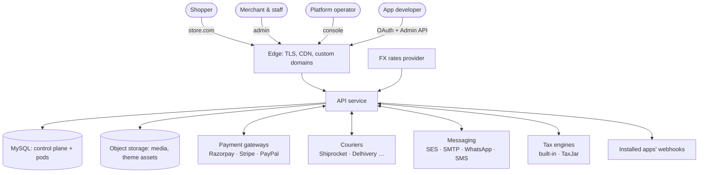
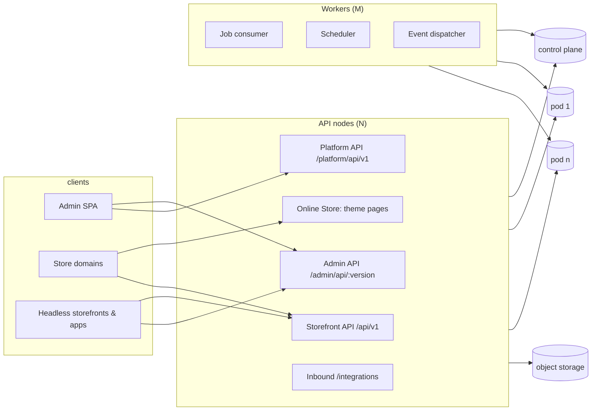
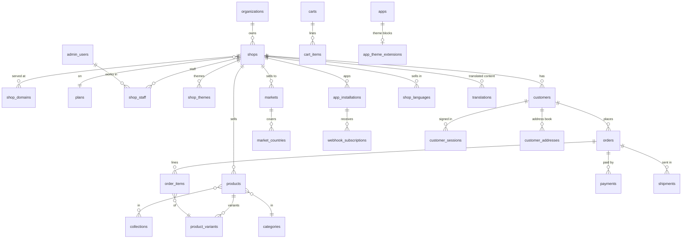
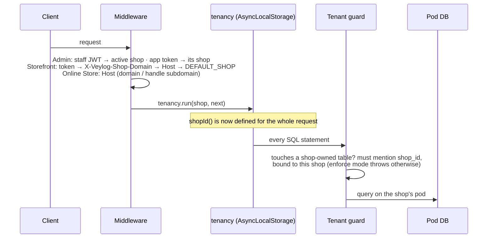
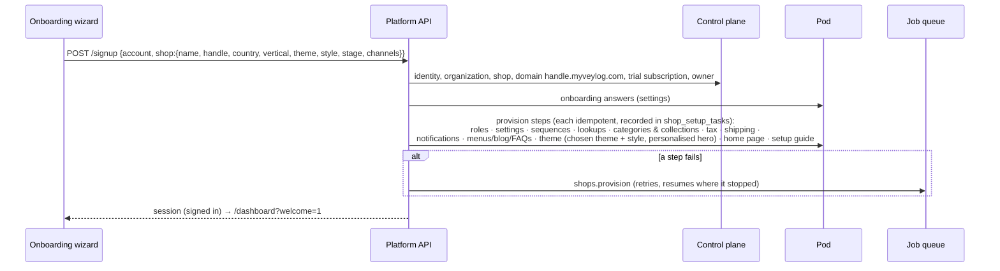
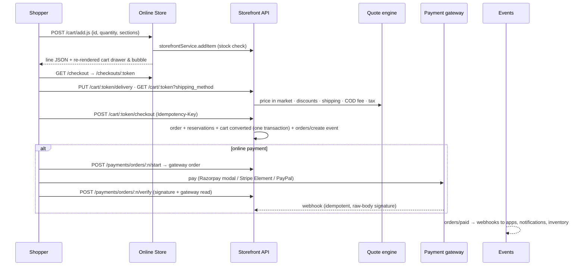
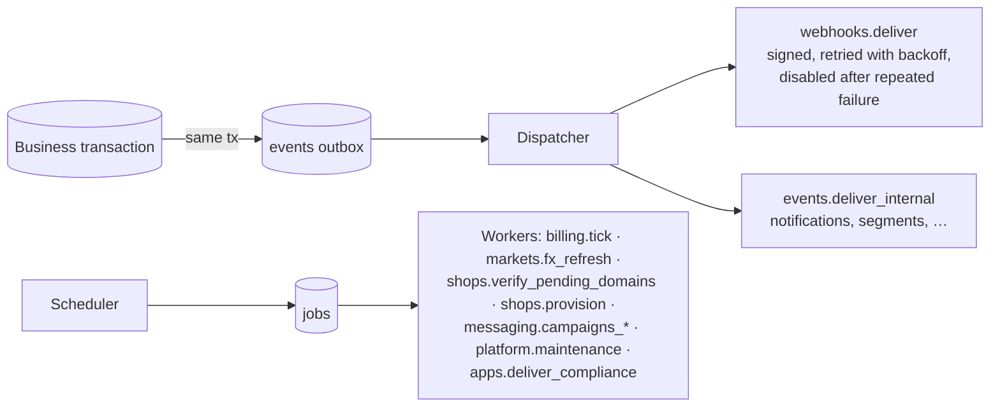

# Veylog — system design

The platform as a whole: what it is made of, how a request travels through
it, how data is laid out, and how each part is built inside. Companion
documents:

* [PLATFORM.md](PLATFORM.md) — the operator's map: tenancy, APIs, a shop's
  life, integrations, billing, markets, running it.
* [ONLINE_STORE.md](ONLINE_STORE.md) — themes, the Liquid renderer, the
  theme editor, checkout.
* [DB_SCHEMA.md](DB_SCHEMA.md) — every table, column, index and foreign
  key, generated from the database.

Veylog is a multi-tenant commerce platform in Shopify's mould: any number of
independent stores on shared infrastructure, each with its own catalogue,
customers, orders, staff, theme, payment gateways, couriers and messaging —
and no store able to see another's data.

---

# Part 1 — High-level design

## 1. Context



## 2. Containers

| Container | Tech | Responsibility |
|---|---|---|
| **API** | Node 24, TypeScript, Express 4, mysql2, zod, liquidjs | Admin API, Storefront API, Platform API, Online Store (server-rendered themes), OAuth, inbound provider webhooks. Stateless; scale horizontally. |
| **Worker** | same codebase (`src/worker.ts`), or embedded in the API | Job queue consumer, scheduler (billing, FX, domain checks, maintenance, campaigns), event dispatcher (webhooks to apps, notifications). |
| **Admin SPA** | React 19, MUI, TanStack Query, React Router, Vite | Merchant admin, theme editor and code editor, onboarding, operators' console. |
| **Headless storefront** | React, Tailwind (the original Veylor storefront) | Optional: a store can be served by the Storefront API instead of a theme. |
| **Control-plane DB** | MySQL 8 | Platform-wide data: shops, domains, plans, identities, staff memberships, apps, jobs, theme library, billing. |
| **Pod DBs (1..n)** | MySQL 8 | Every shop-owned table, `shop_id` on each row; a shop lives on exactly one pod. |
| **Object storage** | local disk (dev) or S3 | Media library, binary theme assets. |



## 3. Deployment

* **Edge**: Cloudflare for SaaS (recommended) or a self-run Caddy fleet with
  on-demand TLS (`deploy/edge/`) terminates TLS for the platform's wildcard
  and every custom domain, close to shoppers. Custom domains point at their
  own CNAME target (`d-<token>.shops.myveylog.com`) or the edge IPs; the
  platform proves ownership, asks the edge for the certificate, and redirects
  every other address to the primary domain — see [DOMAINS.md](DOMAINS.md).
* **API**: `node dist/src/server.js` behind the edge, `trust proxy` on;
  `/health/live` for restarts, `/health/ready` (every DB answers) for the load
  balancer, `/metrics` (Prometheus, token-protected).
* **Worker**: embedded by default; with more than one API node set
  `WORKER_EMBEDDED=false` and run `npm run start:worker` as its own
  deployment. Jobs are claimed with `SELECT … FOR UPDATE SKIP LOCKED`, so any
  number of workers can run.
* **Databases**: one control plane; `PODS` lists additional pod databases.
  New shops go to the least-full pod accepting shops.
* **Build/deploy**: see `docs/00-DEPLOYMENT-OVERVIEW.md` … `06-*`.

## 4. Data architecture

* **Two kinds of table.** Control-plane tables (the frozen list in
  `src/platform/tenancy/tables.ts`) have no `shop_id`. Every other table is
  shop-owned: `shop_id` first in every primary/unique key, and every foreign
  key is tenant-consistent — `(shop_id, parent_id) → parent(shop_id, id)` — so
  a row can never point at another shop's row even by a bug.
* **Routing.** `pool` resolves to the current shop's pod; repositories never
  name a database. Control-plane access uses `controlPlane` explicitly. A
  transaction cannot span databases, so work that touches both (signup,
  theme installs) is split into steps that are individually idempotent.
* **Money** is `DECIMAL` in the store's currency in the database; the Online
  Store and the AJAX Cart API speak minor units (cents), as Shopify does;
  markets convert at read time.
* **Outbox.** Changes and their events are written in one transaction
  (`events` table); the dispatcher delivers them after commit.
* **Migrations** are numbered SQL files (`database/migrations`), applied by
  `npm run db:migrate`; `schema_migrations` records them.

Core entities (simplified — the full schema is in DB_SCHEMA.md):



## 5. Key flows

### 5.1 Every request: resolve the shop, then run as it



### 5.2 Opening a store



### 5.3 Buying



### 5.4 Events, webhooks and jobs



Topics follow Shopify's names (`orders/create`, `orders/paid`,
`products/update`, `inventory_levels/update`, `themes/publish`,
`themes/update`, `app/uninstalled`, the GDPR `customers/redact` /
`shop/redact` …).

## 6. Cross-cutting qualities

| Quality | How |
|---|---|
| **Isolation** | Tenant context + runtime guard + static `check:tenancy` + tenant-consistent FKs + shop-partitioned caches (`ShopScopedCache`). |
| **Scalability** | Stateless API nodes; pods for data; `SKIP LOCKED` job claiming; theme renders cached per theme version; lazy Liquid objects; indexed, paginated reads everywhere. |
| **Reliability** | Outbox events; idempotent provisioning steps; `Idempotency-Key` on checkout and creates; webhook retries with dead-lettering; payment verification by signature *and* gateway read; a broken theme section never takes a page down. |
| **Security** | bcrypt passwords, short-lived JWT + rotating refresh (reuse = theft = session killed), per-permission RBAC, app scopes, HMAC-signed webhooks and preview links, rate limits (shared buckets across nodes), raw-body webhook verification, CSP `frame-ancestors` for the editor, `noindex` previews, no secrets in logs. |
| **Observability** | Structured JSON logs with request ids, Prometheus metrics, audit trail for every staff action, `/health/*`. |
| **Compatibility** | Admin API is date-versioned (`2026-10`; `v1` alias); themes follow Shopify's format; the AJAX Cart API, Section Rendering API and product JSON match Shopify's shapes. |

## 6a. Global scale

The target: stores anywhere, shoppers everywhere, millions of domains, one
platform. What each layer does to get there:

| Layer | Scales by | Notes |
|---|---|---|
| Edge (TLS, WAF, cache) | The provider's anycast network, or more Caddy nodes per region with shared certificate storage | The application holds no certificates; the edge worker (`deploy/edge/worker/`) routes by hostname to the shop's region, answers redirects itself and serves anonymous pages from its cache |
| API | Stateless pods behind a regional load balancer; add pods | Hostname → shop resolution is cached per pod and cleared on change on every pod |
| Workers | More workers | Jobs by `SKIP LOCKED`; the domain sweep by leased batches — both linear |
| Shop data | More pods (databases), placed per region | A shop lives on one pod; data residency follows placement; a pod's failure affects only its shops |
| Control plane | One primary, a read replica per region | Small, read-mostly (shops, domains, identities); writes are merchant/operator actions |
| Theme rendering | Per-theme-version engine and template caches; lazy Liquid objects; full-page cache per pod and at the edge | Anonymous pages are cached under the shop's content version, which any committed change bumps — no purges; a cache hit reads nothing from the database ([ONLINE_STORE §3.8](ONLINE_STORE.md#38-caching-and-invalidation)) |
| Per-shop caches across pods | Content-version poll: one query per pod every 2 s lists the shops that changed | Every pod clears its caches for those shops, so cross-pod staleness is seconds, not TTLs |
| Domains | Backing-off, jittered checks; light health checks; edge asked only during issuance or near expiry | ~46 checks/s and ~140 DNS queries/s at a million live domains ([DOMAINS.md §5](DOMAINS.md#5-scale)) |

Failure isolation follows the same lines: an edge PoP fails over by anycast;
a region's API pods fail over by DNS/load balancer health; a pod database
fails over to its replica and affects only the shops placed on it; the
control plane's replicas keep hostname resolution working in every region
while the primary is replaced.

---

# Part 2 — Low-level design

## 7. Code layout and layering

```
src/
  app.ts, server.ts, worker.ts     wiring: middleware, routers, boot
  config/env.ts                    all configuration, validated at start
  core/                            ApiError, logger, asyncHandler
  db/                              pools (control plane + pods), query helpers, transactions
  middleware/                      authenticate, requirePermission, validate (zod), rateLimit,
                                   idempotency, requestContext, upload, errorHandler
  modules/<domain>/                the commerce domain: routes → controller → service → repository
  platform/<concern>/              multi-tenant platform: tenancy, shops, plans, billing, apps,
                                   webhooks, events, jobs, integrations, markets, tax, mail,
                                   notifications, themes, onlineStore, observability, security
  shared/                          audit service and cross-module helpers
themes/                            the built-in themes' source (_kit + 9 overlays)
database/migrations/               numbered SQL migrations
scripts/                           migrate, seed, smokes, checks, theme CLI, schema docs
test/unit/                         node:test suites
```

Rules: a **route** validates input (zod) and checks permission; a
**service** holds the business rules and owns transactions
(`withTransaction`); a **repository** is SQL only (mysql2, no ORM), every
statement scoped by `shopId()`. Errors are `ApiError`s with a stable `code`
and field-level `details`; the error handler turns them into
`{ error: { code, message, details, request_id } }`.

## 8. Module catalogue

| Area | Modules | Notable design points |
|---|---|---|
| Identity & staff | `auth`, `admin-users`, `roles`, `platform/security` | Identities (`admin_users`) are platform-wide; memberships per shop (`shop_staff`); permissions per role; sessions with rotating refresh tokens; account recovery by platform email. |
| Catalogue | `products`, `categories`, `collections`, `inventory`, `lookups`, `link-targets` | Variants with option values and swatches; vertical-specific attributes and metafields; reservations on checkout; low-stock and back-in-stock. |
| Selling | `storefront`, `carts`, `orders`, `payments`, `invoices`, `returns`, `shipments`, `shipping` | One quote engine prices bags, checkouts and orders (market, discounts, free-delivery threshold, COD fee, tax); gateway adapters behind one interface (`PaymentGateway`). |
| Pricing & tax | `discounts`, `tax`, `platform/tax`, `platform/markets`, `platform/money` | GST (CGST/SGST/IGST), VAT and US sales tax (built-in or TaxJar); markets with FX, adjustment and rounding; currency-aware rounding everywhere. |
| Customers & marketing | `customers`, `segments`, `newsletter`, `messaging`, `reengagement`, `reviews` | Consents with evidence; campaigns rate-limited per provider; abandoned-cart recovery links. |
| Content | `content/*`, `merchandising`, `navigation`, `media`, `creators` | Pages, journal, FAQs, banners, menus (used by themes' `linklists`), a media library with variants. |
| Platform | `platform/shops` (signup, provisioning, domains, brand), `plans`, `billing`, `apps` (OAuth, scopes, custom apps, storefront tokens), `webhooks`, `events`, `jobs`, `integrations`, `notifications`, `mail`, `observability` | See PLATFORM.md. |
| Online Store | `platform/themes`, `platform/onlineStore`, `platform/apps/themeExtensions` | Liquid themes, the editor, customer accounts, languages and translations, app blocks. See ONLINE_STORE.md. |
| Gift cards | `modules/giftCards` | Issued by staff or sold as products; spent at checkout as a payment (locked, balance-guarded debits in the order's transaction); credited back on cancel/refund; the card's page. See ONLINE_STORE.md §3.12a. |
| Domains | `platform/domains` (hostnames, DNS inspection, lifecycle, edge providers, registrar, host routing, sweep) | Connect / buy / move domains, primary + redirects, market domains, certificates at the edge. See DOMAINS.md. |

## 9. Selected internals

### 9.1 Tenancy (`src/platform/tenancy`)

* `context.ts` — `tenancy.run(shop, fn)` / `tenancy.current()` /
  `tenancy.unscoped(reason, fn)`; `shopId()` throws outside a shop.
* `guard.ts` — wraps every pool's `query`/`execute`; parses the statement,
  finds shop-owned tables, requires a `shop_id` predicate bound to the
  current shop (`TENANT_GUARD=enforce|warn|off`).
* `resolveShop.ts` — the Storefront API's shop resolution;
  `storefrontGate.ts` — the password gate (signed unlock tokens bound to the
  password hash).
* `sqlScan.ts` + `scripts/check-tenancy.ts` — the static check over the
  TypeScript AST.

### 9.2 Jobs (`src/platform/jobs`)

`defineJob({ type, queue, shopScoped, maxAttempts, backoff, timeoutMs,
handler })`. `jobQueue.enqueue(type, payload, { shopId, uniqueKey,
runAt })` — `uniqueKey` de-duplicates. Workers claim with `SKIP LOCKED`,
run shop-scoped jobs inside `tenancy.run`, retry with exponential backoff and
jitter, dead-letter on `PermanentJobError` or exhaustion, and reclaim hung
jobs after `timeoutMs`. The scheduler enqueues recurring jobs once per slot
across all nodes.

### 9.3 Webhooks and apps

Apps authenticate with OAuth (authorization code → offline token, scopes
checked per route) or as custom apps; webhooks are HMAC-SHA256 signed
(`X-Veylog-Hmac-Sha256`), delivered with retries, and a subscription that
keeps failing is disabled with a `webhooks.subscription_disabled` notice.
GDPR compliance topics are delivered on install/uninstall/redact. An app can
also ship a theme extension — Liquid blocks and app embeds the merchant places
in the theme editor — which renders only while the app is installed
(ONLINE_STORE.md §3.12).

### 9.4 Payments

`PaymentGateway` (create order, resume, checkout payload, confirm client
payment, verify webhook, refund) with Razorpay, Stripe and PayPal adapters;
credentials per shop (`integrations`); a payment is only settled after the
claim is proven (signature) **and** read back from the gateway, and the
amount is checked against what the order is owed.

### 9.5 Caching

In-process caches are always `ShopScopedCache` (partitioned by shop, TTL,
`clear()` on writes). Hot reads: shop directory (by host/handle/id), markets
and FX, brand, theme files per version, Liquid engines per theme version,
headless theme tokens. Nothing is cached across shops.

### 9.6 Rate limiting and idempotency

`rateLimit({ bucket, max, windowSeconds, blockSeconds })` counts in MySQL so
limits hold across nodes (signup 5/hour, cart writes 60/min, contact form,
password page…). `idempotency` stores the first response for an
`Idempotency-Key` and replays it; a concurrent duplicate gets `409`.

## 10. API conventions

* JSON, `snake_case`, ISO-8601 UTC timestamps, money as decimal numbers in
  the shop's currency (Admin/Storefront API) or minor units (Online Store
  AJAX), ids as numbers for shop data and UUIDs for anything exposed across
  shops (shops, themes, apps).
* Lists: `?page=&limit=` (max 100) → `{ items…, pagination: { total, page,
  limit, pages, has_next, has_prev } }`.
* Validation errors: `422 VALIDATION_FAILED` with `details: { field:
  [messages] }`; plan limits: `402`; conflicts: `409` with a specific code
  (`SLUG_TAKEN`, `STALE_FILE`, `IN_USE`…).
* Admin API versions: `/admin/api/2026-10/...`; responses carry
  `X-Veylog-Api-Version`, and a deprecated version adds a warning header.

## 11. Testing and verification

`npm run verify` = typecheck + unit tests (`test/unit`, node:test via tsx) +
`check:sql` + `check:tenancy` + `check:themes`. Smoke suites (`npm run
smoke:*`) exercise real flows against a running server and a scratch
database; the admin repository has Playwright UI smokes (`scripts/ui-smoke-*.mjs`:
themes and the editor, onboarding, and the Online Store's settings with a
shopper signing in, and domains: connect → DNS → live → primary → redirects
→ buy).
